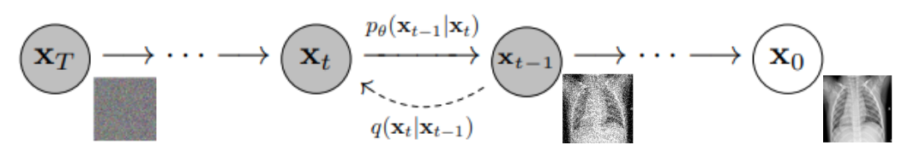
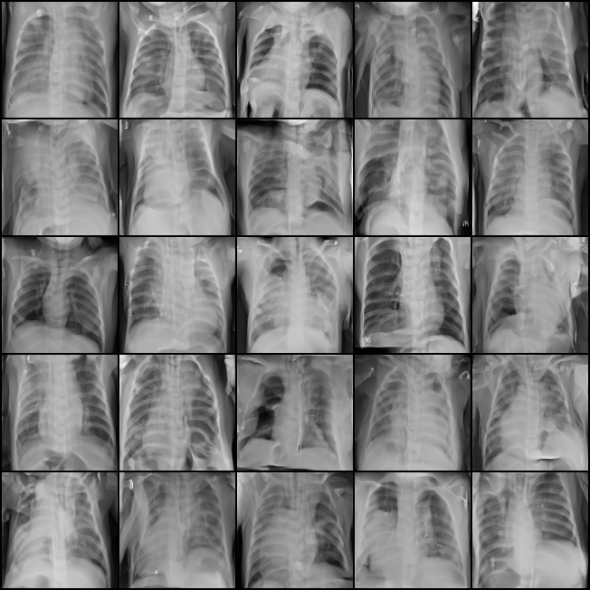

# Chest X-ray generation with a denoising diffusion model

Unconditional generation of chest X-rays with a [Denoising Diffusion Probabilistic Model](https://arxiv.org/abs/2006.11239) [1], trained at 128×128 on a public chest radiography dataset [2] ([Kaggle](https://www.kaggle.com/datasets/francismon/curated-covid19-chest-xray-dataset)).



## Samples

Samples from the trained model:



Pre-trained checkpoint: [download](https://drive.google.com/file/d/1EhrEUjh0wgG_BDNKzUHJd0lO5zQyt7JM/view?usp=sharing). Sampling is shown in `src/notebooks/inference-notebook.ipynb`.

## Scope and credits

The U-Net and the Gaussian diffusion code are adapted from [lucidrains/denoising-diffusion-pytorch](https://github.com/lucidrains/denoising-diffusion-pytorch). This repository adds:

- single-channel (grayscale) training on radiographs,
- a dataset and normalization pipeline for the X-ray images,
- a YAML-driven training entry point,
- an inference notebook and a released checkpoint.

No quantitative evaluation (FID, downstream task) is reported here.

## Usage

Requirements: Python 3.10, [Poetry](https://python-poetry.org/).

```bash
poetry install
```

Set the data path in `src/config/settings.py`, adjust `src/config/training_config.yaml`, then:

```bash
poetry run python src/training/train.py
```

Or from Python:

```python
import torch

from src.models.denoising_diffusion import GaussianDiffusion
from src.models.unet import Unet
from src.training.trainer import Trainer

model = Unet(dim=128, channels=1, dim_mults=(1, 2, 4, 8))

diffusion = GaussianDiffusion(
    model,
    image_size=128,
    timesteps=1000,
    sampling_timesteps=250,  # DDIM sampling
)

trainer = Trainer(
    diffusion,
    "path/to/images",
    device=torch.device("cuda"),
    train_batch_size=32,
    train_lr=8e-5,
    train_num_steps=700000,
    gradient_accumulate_every=2,
)
trainer.train()
```

## References

[1] J. Ho, A. Jain, P. Abbeel. *Denoising Diffusion Probabilistic Models*. NeurIPS 2020. arXiv:2006.11239.  
[2] U. Sait et al. *Curated Dataset for COVID-19 Posterior-Anterior Chest Radiography Images (X-Rays)*. Mendeley Data, 2020.
